Bellota & Bellota Text font families
==============================
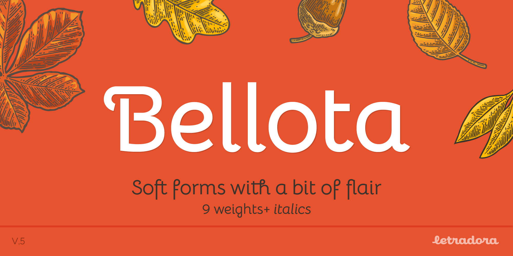
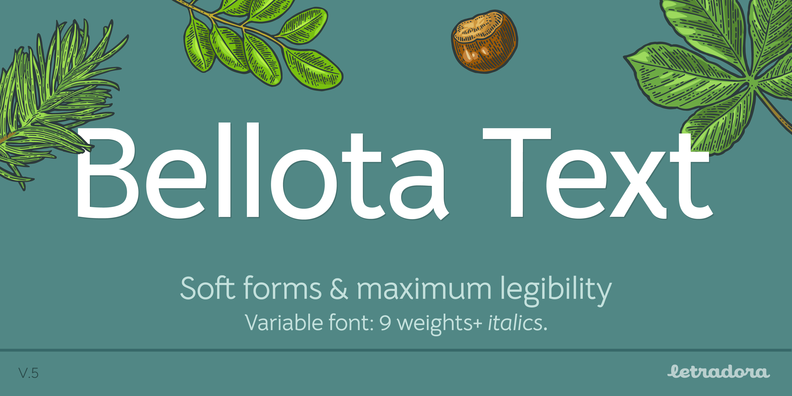

Bellota is an ornamented, low contrast sans-serif with swash alternates. It’s just cute enough!


It comes in two subfamilies: **Bellota** and **Bellota Text**. Each of these comes in 9 weights (thin, extralight, light, regular, medium, semibold, bold, extrabold, black) with their corresponding italics. Bellota also comes as a variable font. 

Bellota has stylistic alternate sets and ligatures available through opentype features.

* Stylistic Style1: Text
* Stylistic Style 2: Swash caps

Bellota supports most latin languages and basic cyrillic

Bellota is based on the font "Snippet" by Gesine Todt (www.gesine-todt.de)


To contribute to the project contact  Kemie Guaida at [hi@letradora.com](mailto://hi@letradora.com)


# License	  
The **Bellota Family** is licensed under the [SIL Open Font License Version 1.1](http://scripts.sil.org/OFL). The Open Font License is a free software license, and as such permits the fonts to be used, modified, and distributed freely (so long as the resulting fonts remain under the Open Font License). 

In other words, you are free to use it for any purpose, commercial included.

If you remix or modify the font, I'd love to hear about it!.

# Build
The fonts are built from the `.glyphs` sources with [gftools builder](https://github.com/googlefonts/gftools):

```sh
./build.sh        # creates a virtualenv from requirements.txt on first run
./build.sh --qa   # same, then runs fontbakery (needs fontbakery installed)
```

Output, one folder per family (`fonts/bellota/` and `fonts/bellotatext/`), each with `variable/` (variable fonts), `ttf/` (statics, autohinted) and `webfonts/` (woff2).

Bellota Text is defined by the custom parameters of the instances in the Glyphs files (*Rename Glyphs*, *Decompose Glyphs*, *Remove Glyphs*, *Remove Features*), which glyphsLib ignores ([google/fonts#8239](https://github.com/google/fonts/issues/8239)). The build applies them itself:

1. `sources/scripts/prepare_sources.py` reads every *Variable Font Setting* of the `.glyphs` files and writes one designspace per family/style in `sources/build/`, with *Decompose Glyphs* and *Rename Glyphs* applied the way Glyphs.app does (composites are re-aligned, corner components and the stroked `.notdef` are expanded).
2. `gftools builder sources/config.yaml` builds the fonts. Its `postCompile` step runs `sources/scripts/postcompile.py`, which applies *Remove Glyphs* and *Remove Features* to each compiled font.

The `.glyphs` files remain the only sources: edit the instance custom parameters in Glyphs.app and run `./build.sh` again. Check the `WARNING` lines of the pre-build step, they point at problems in the sources.

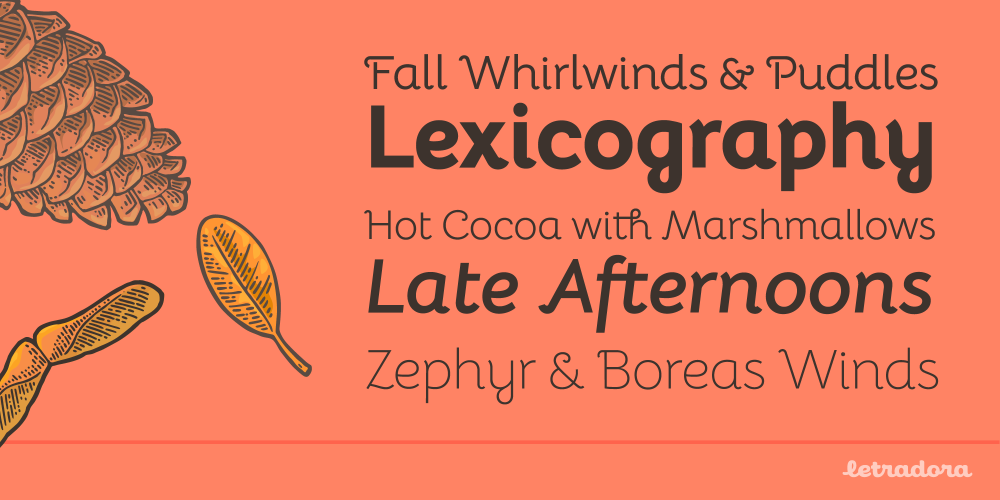
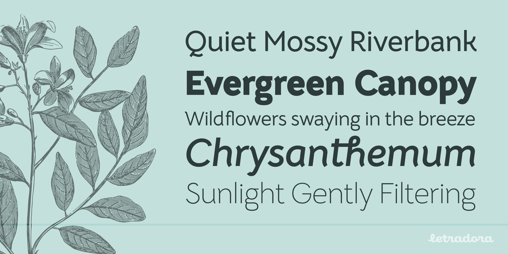
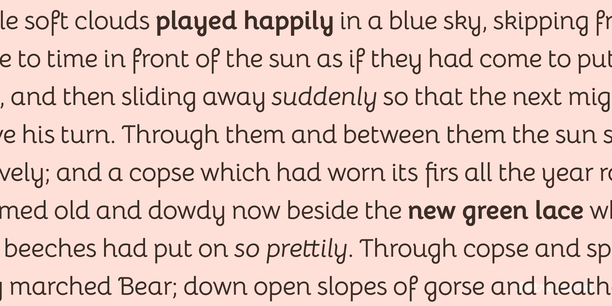
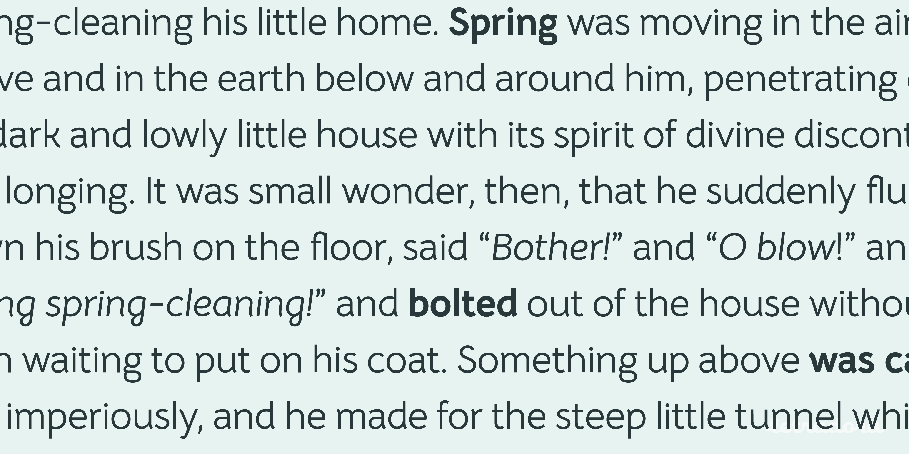
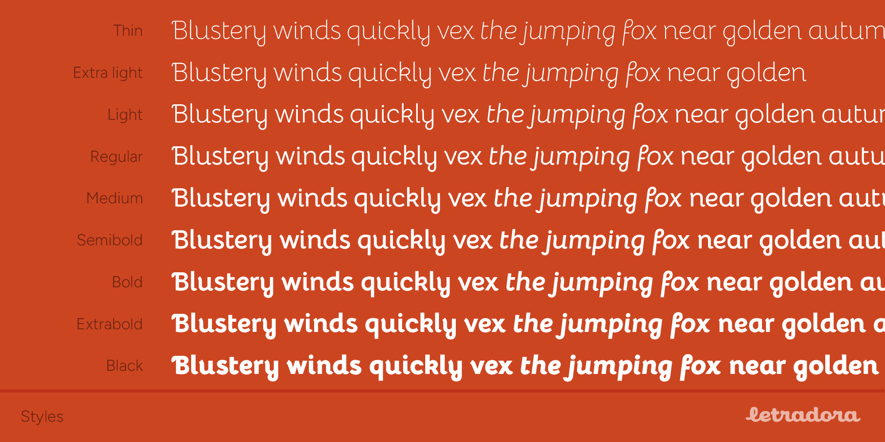
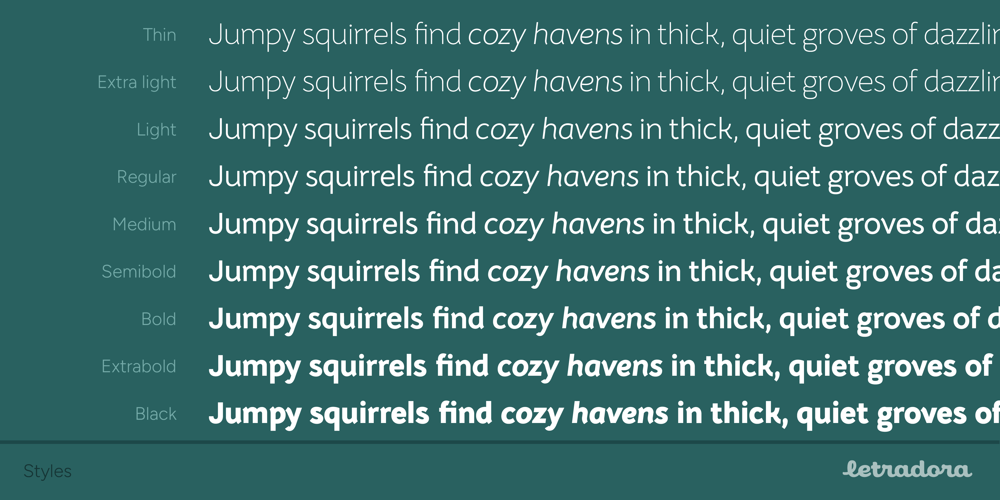
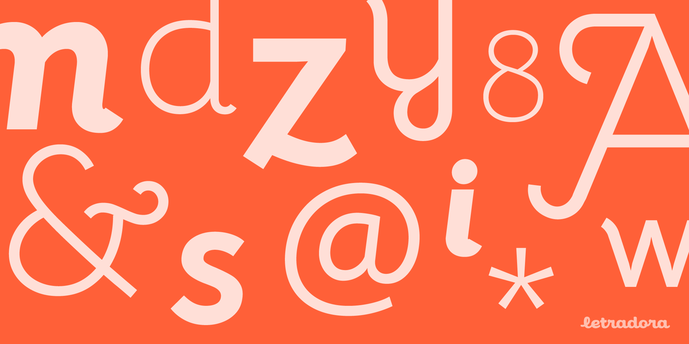
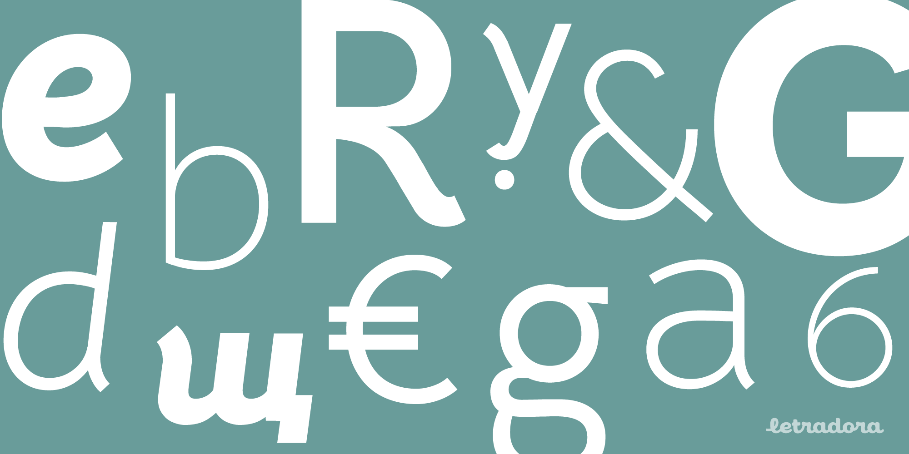
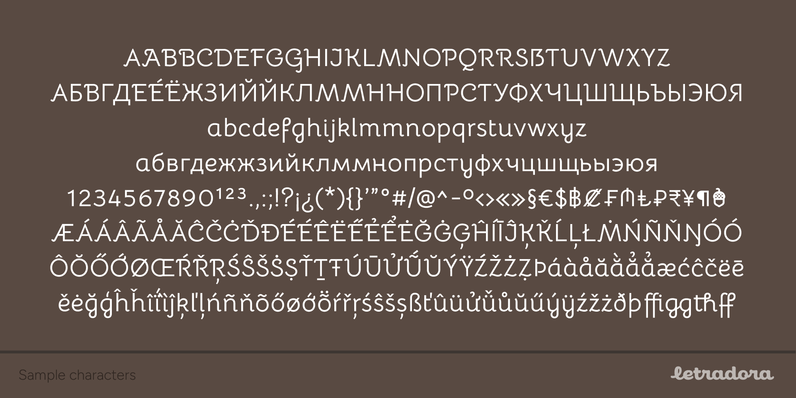
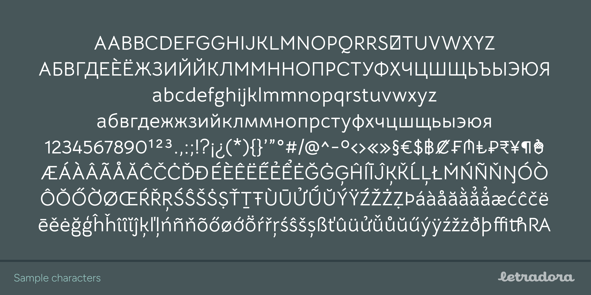
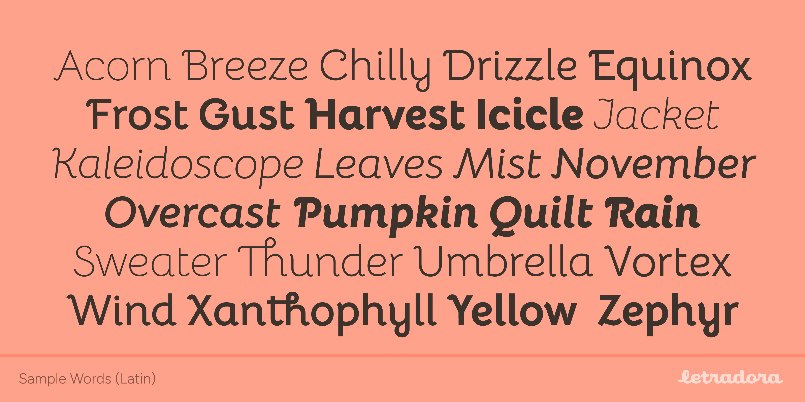
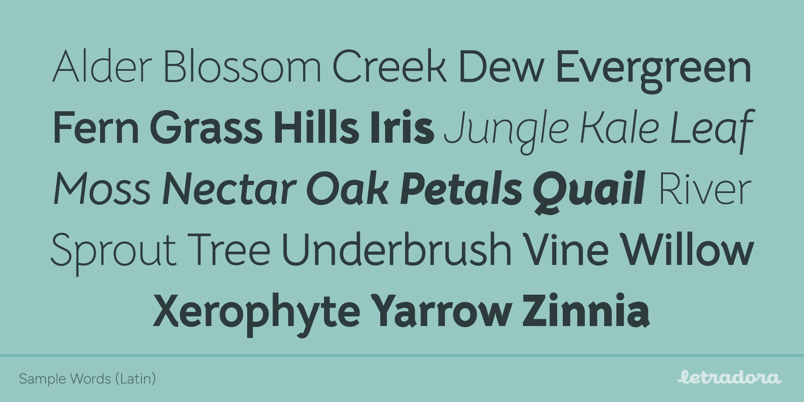
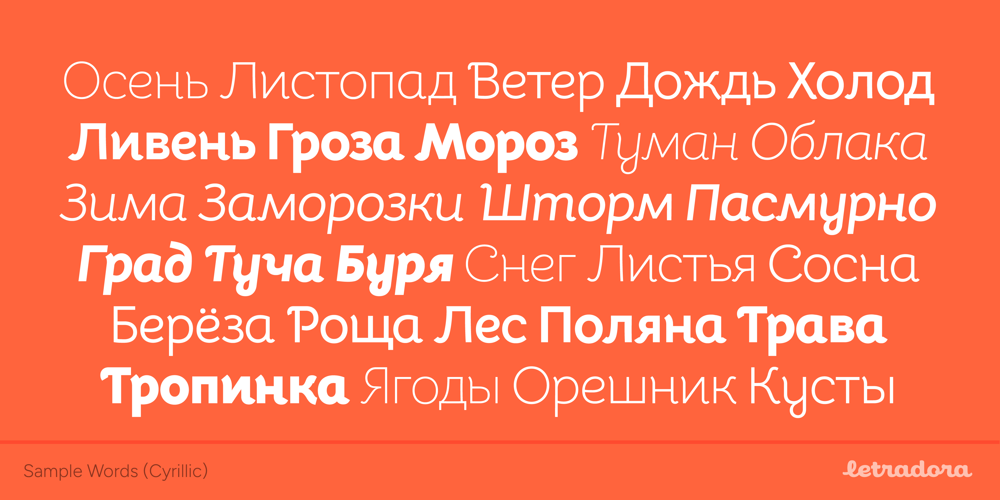

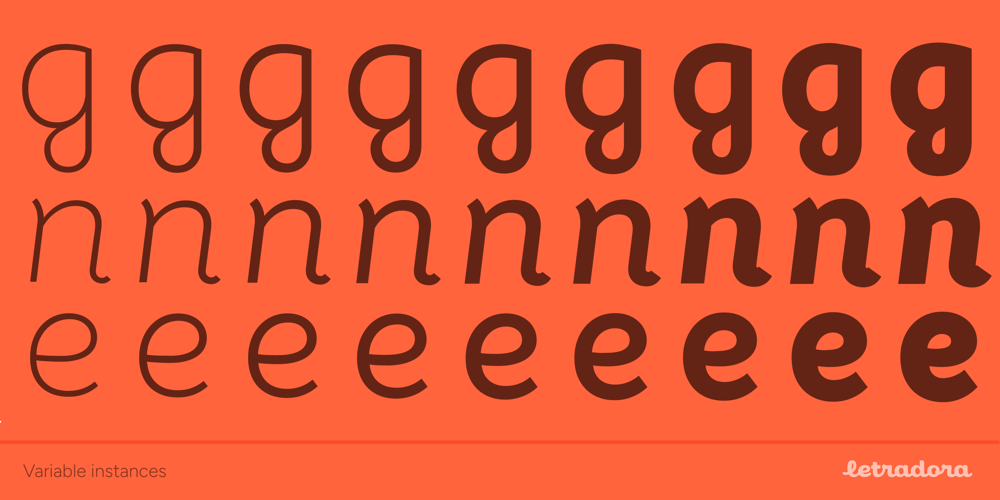
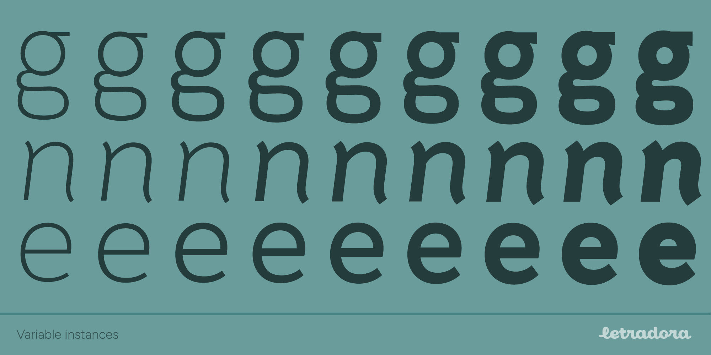
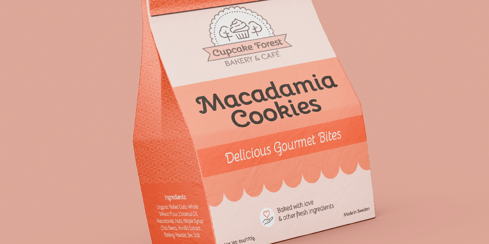


# Changelog	
————————————————————————————————
## Build update, Nov 2026 (Emma Marichal)
+ New build process with gftools builder (`build.sh`, `sources/config.yaml`), replacing the TTFs exported from Glyphs.app
+ Bellota Text is now built from the custom parameters of the Glyphs instances (Rename, Decompose and Remove Glyphs, Remove Features), which glyphsLib doesn't support
+ Fonts sorted by family: `fonts/bellota/` and `fonts/bellotatext/` (variable, static TTF, woff2)
+ Italic variable fonts now default to Italic (400) instead of Thin Italic
+ Bellota Text keeps ẞ (U+1E9E), which the Glyphs export dropped
+ Fixed advance widths of Đ, Dž and dž in Bellota Text
+ Fixed the weight of the Bellota Text Thin Italic static and the naming of the ExtraLight Italic statics
+ Static file names now use ExtraLight, SemiBold and ExtraBold

=V 5.05, Jan 2026 (Kemie Guaida)=
+  Improvements to cyrillic characters

## V 5.04, Dec 2025
+ Better spacing
+ Changed masters medium-->regular
+ Fixed some outline errors

## v5.0, Sept 2024
+ Expanded weights: thin to black
+ Variable font support
+ Better spacing and kerning
+ Better consistency on character outlines
+ Expanded character set 

## v4.1, Jan 2020
+ Bumped to Google Fonts specs 

## v4.0, Oct  2019 
+ Basic Cyrillic support
+ Better Vietnamese diacritics
+ Wider character coverage
+ Better spacing and kerning
+ Better consistency on character outlines
+ Added Swash characters
+ Changed Stylistic Set 2 to 1

## v3.0, May 2017
+ Better spacing and kerning
+ Fixed some character outlines
+ Added more characters to Stylistic Set 2
+ Fixed vertical metrics 
## v2.5, June 2015
+ First uploaded to GitHub
+ Added support for Vietnamese
+ Minor fixes.

# Questions? Comments?
The font was made and is maintained by [Kemie Guaida](https://www.letradora.com). 

If you have questions or suggestions, you can open an issue here at github, or ping me via instagram [@kemie](https://www.instagram.com/kemieg/)